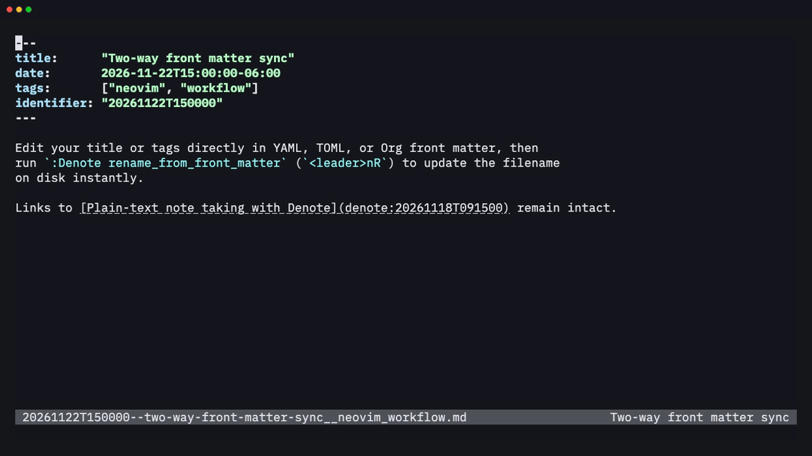
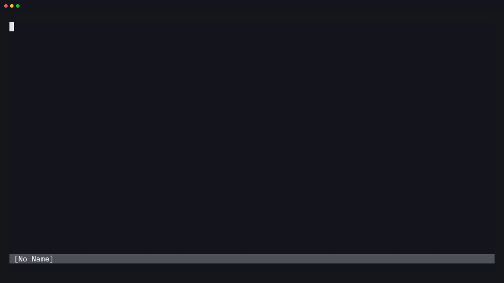
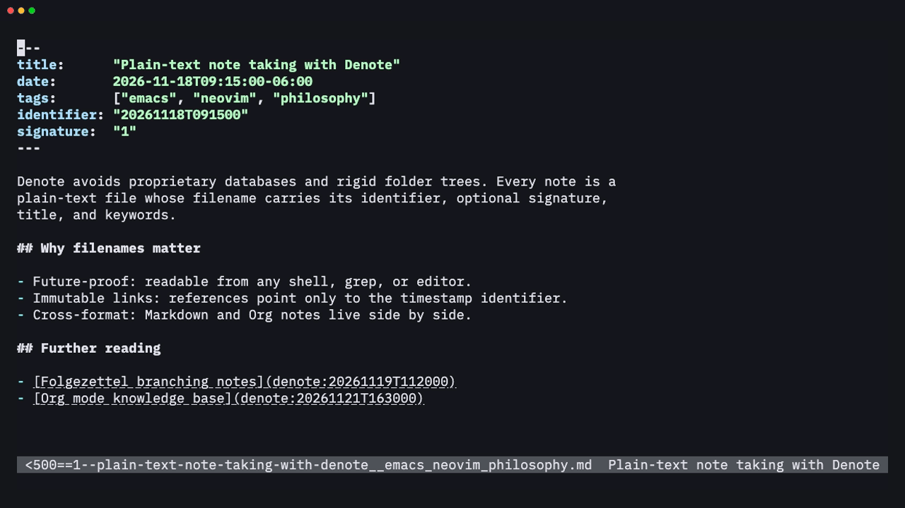
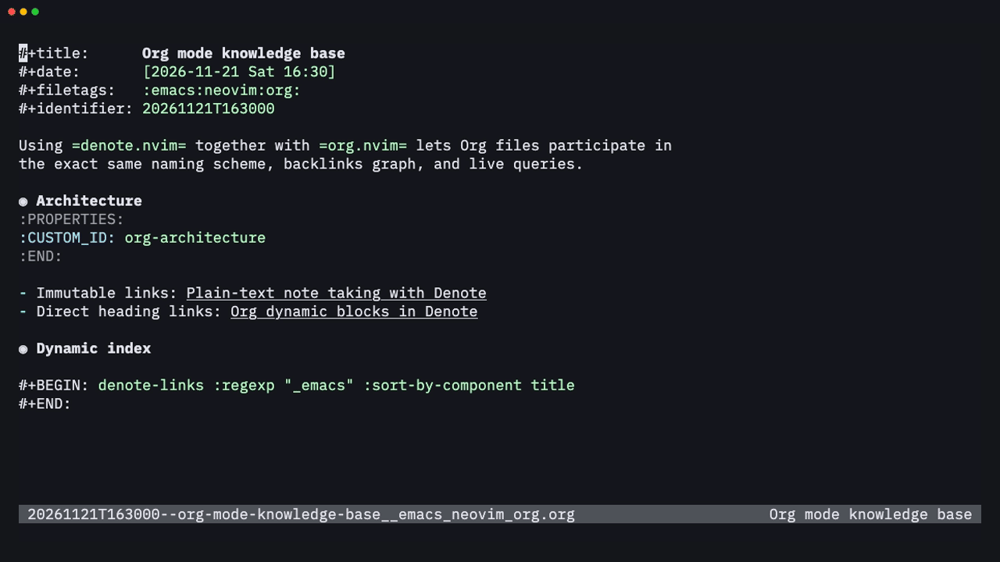
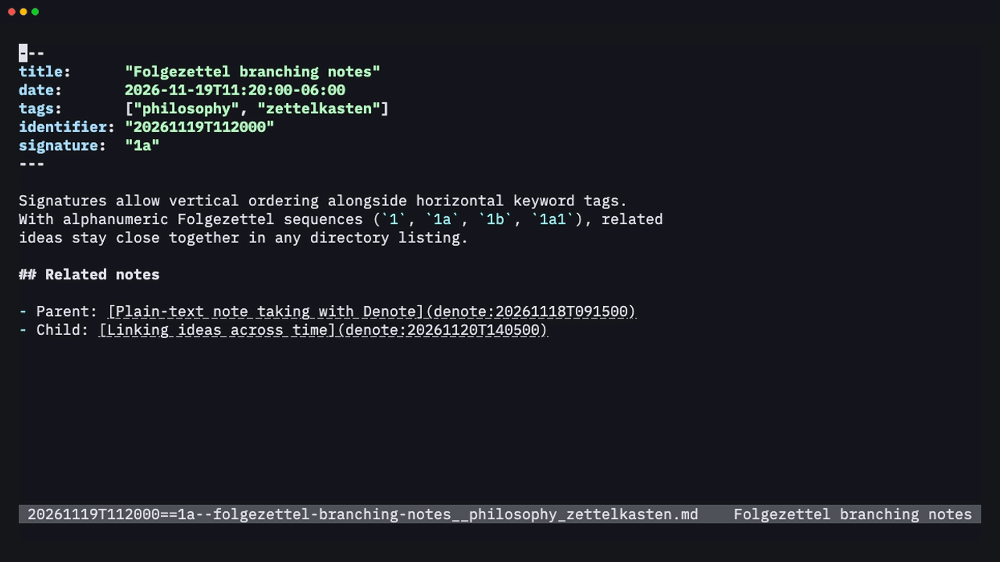

<div align="center">

# denote.nvim

### Emacs Denote, rebuilt for Neovim in pure Lua.

File-naming scheme · Org & Markdown · Backlinks · Query links · Explorer · Silos · Journal · Sequences

[](https://neovim.io)
[](lua/denote)
[](#-install-in-30-seconds)
[](LICENSE)
[](https://github.com/xheisenbugx/denote.nvim/actions/workflows/ci.yml)
[](#-contributing)

**[Install](#-install-in-30-seconds)** ·
**[Tour](#-a-quick-tour)** ·
**[Quick start](#-quick-start)** ·
**[Features](#-features)** ·
**[Org & Markdown](#-org-mode-orgnvim--markdown)** ·
**[Commands & Keys](#-commands--keymaps)** ·
**[Configuration](#-configuration)** ·
**[Manual](doc/denote.txt)** ·
**[Contributing](#-contributing)**

<br>


</div>

---

[Denote](https://protesilaos.com/emacs/denote) by Protesilaos Stavrou is one of the most loved note-taking packages in Emacs. Instead of locking your notes inside a SQLite database or a rigid folder hierarchy, Denote relies on plain text and a strict, predictable, human-readable **file-naming scheme**:

```text
DATE==SIGNATURE--TITLE__KEYWORDS.EXTENSION
20261123T191500==1a--my-note-title__emacs_neovim.org
```

**denote.nvim brings the complete Denote ecosystem to Neovim in pure Lua** — including core note creation, two-way filename/front-matter renaming, identifier-based links, heading links, live query links, backlinks, full-text grep, an interactive Dired-style explorer, silos, daily journals, Folgezettel sequences, and native integration with **[org.nvim](https://github.com/xheisenbugx/org.nvim)**.

- 🪶 **Zero dependencies.** 100% pure Lua. No SQLite, no tree-sitter parser, no external binary required (uses `rg` automatically when available, with a pure-Lua fallback).
- 🔁 **100% compatible with Emacs Denote.** Reads and writes the exact same filenames, front matter, and `denote:` links — edit a note in Emacs today and Neovim tomorrow without changing a single byte.
- 📝 **First-class Org & Markdown.** Full support for `org` (`.org`), `markdown-yaml` (`.md`), `markdown-toml` (`.md`), and `text` (`.txt`), plus deep native hooks for **[org.nvim](https://github.com/xheisenbugx/org.nvim)** (`denote:` link following, storing, export, and `#+BEGIN: denote-*` dynamic blocks).
- 🗂️ **Works on any file.** Rename PDFs, images, videos, or encrypted `.org.gpg` / `.md.age` files into the Denote scheme just like notes.
- 💤 **Ready for LazyVim & modern setups.** Auto-detects `snacks.nvim`, `fzf-lua`, `telescope.nvim`, `mini.pick`, or falls back to `vim.ui.select`; ships with `which-key` groups, `blink.cmp` & `nvim-cmp` completion sources, a statusline helper, and `:checkhealth denote`.
- ✅ **Tested headlessly.** Every feature ships with automated headless Neovim specs (`make test`).

---

## ⚡ Install in 30 seconds

With [lazy.nvim](https://github.com/folke/lazy.nvim) / LazyVim:

```lua
-- ~/.config/nvim/lua/plugins/denote.lua
return {
  "xheisenbugx/denote.nvim",
  opts = {
    directory = "~/Documents/notes",
    file_type = "markdown-yaml", -- "org", "markdown-yaml", "markdown-toml", or "text"
    known_keywords = { "emacs", "neovim", "philosophy", "work" },
  },
}
```

With [rocks.nvim](https://github.com/nvim-neorocks/rocks.nvim):

```vim
:Rocks install denote.nvim
```

### Pairing with [org.nvim](https://github.com/xheisenbugx/org.nvim)

No extra glue code needed — set `file_type = "org"` (or mix `.org` and `.md` notes freely in the same directory) and `denote.nvim` automatically hooks into `org.nvim`:

```lua
return {
  "xheisenbugx/denote.nvim",
  opts = {
    directory = "~/org/notes",
    file_type = "org",
    known_keywords = { "org", "neovim", "projects", "journal" },
  },
}
```

Restart Neovim and run `:checkhealth denote` to verify your directory, picker backend, and `org.nvim` integration.

---

## 🚀 Quick start

1. Press `<leader>nn` (or run `:Denote`) to create a new note — enter a title and keywords.
2. Press `<leader>no` (`:Denote open`) to fuzzy-find an existing note or create a new one from your typed query (`<M-CR>` in snacks/telescope).
3. Press `<leader>nl` (`:Denote link`) to insert an immutable `denote:IDENTIFIER` link — formatted automatically for Org (`[[denote:ID][Title]]`) or Markdown (`[Title](denote:ID)`).
4. Put the cursor on any `denote:` link and press `<CR>` to follow it (even if you renamed or moved the target file).
5. Press `<leader>nb` (`:Denote backlinks`) to open the interactive backlinks split, or `<leader>ne` (`:Denote explorer`) to browse, filter, sort, mark, and batch-rename notes.
6. Edit a note's title or tags inside its front matter and press `<leader>nR` (`:Denote rename_from_front_matter`) to sync the filename on disk.

> [!TIP]
> All global Denote keymaps live under `<leader>n` by default. If another plugin already uses it, change `mappings = { prefix = "<leader>N" }` or disable them with `mappings = { enabled = false }`. Inside Explorer, Backlinks, and Query buffers, press `g?` anytime for a keymap cheatsheet.

---

## 🎬 A quick tour

Recorded in a standalone Neovim from the VHS tapes in [`docs/media/tapes`](docs/media/tapes) (config: [`docs/media/demo/init.lua`](docs/media/demo/init.lua)). The box in the bottom-right corner shows the key being pressed. All GIFs are hosted on the orphan [`media`](https://github.com/xheisenbugx/denote.nvim/tree/media) branch so installing the plugin stays lightweight.

### Creating notes & two-way front matter sync

`<leader>nn` creates a note with its timestamp identifier, slugified filename, and front matter. Edit the title or tags directly inside the file and press `<leader>nR` to sync the filename on disk — or press `<leader>nk` / `<leader>nr` to update both at once.


### Immutable links, heading links & backlinks

`<leader>nh` links directly to a specific heading (`::#heading-slug` in Markdown, `::#custom-id` or `::*Heading` in Org), `<CR>` jumps right to it, and `<leader>nb` opens an interactive backlinks split across both `.md` and `.org` notes (`f` toggles matching context vs filenames-only).



### Interactive Denote Explorer

`<leader>ne` opens a colorized Dired-style buffer (`denote-sort-dired` / `denote-menu`): sort naturally by Folgezettel signature (`S`), reverse order (`r`), filter by keyword (`k`) or regexp (`/`), mark notes for batch renaming (`m` + `R`), and press `g?` for all explorer keymaps.



### Full-text grep & Denote 4.0 live query links

`<leader>ng` runs a fast full-text search into a live narrowing buffer (`f` keep matching, `x` exclude, `c` clear). `<leader>nqc` inserts a `denote:query-contents:` link that re-executes the search whenever you press `<CR>` on it.



### First-class `org.nvim` integration

When paired with [xheisenbugx/org.nvim](https://github.com/xheisenbugx/org.nvim), `denote.nvim` registers the native `denote:` link type and Org dynamic blocks (`denote-links`, `denote-backlinks`, `denote-files`). Links render with `org.nvim` concealment, `<CR>` jumps straight to `:CUSTOM_ID:` headings, `:Denote dblock_update` populates dynamic index blocks live, and backlinks span `.org` and `.md` notes seamlessly.



### Folgezettel sequences & daily journal

Browse sequence relatives (`<leader>nzr` — parent, siblings, children), spawn the next child in an alphanumeric or numeric tree (`<leader>nzc` → `1a2`), and open or create today's journal entry in one press (`<leader>nj`).



---

## ✨ Features

| | Area | Highlights |
| --- | --- | --- |
| 🏷️ | **File-naming scheme** | Canonical `DATE==SIGNATURE--TITLE__KEYWORDS.EXTENSION`, Denote 3.x/4.x reordered components (`@@DATE`), collision-free timestamp IDs, compound extensions (`.org.gpg`, `.md.age`), custom sluggifiers, and arbitrary non-text files (PDFs, images) |
| 📄 | **Front matter & templates** | Built-in `org`, `markdown-yaml` (inline & block YAML lists), `markdown-toml`, and `text` formats, custom file types, named body templates (static strings or Lua functions), and `:DenoteRegion` with automatic code block wrapping |
| 🔄 | **Two-way renaming** | Rename any file (`:Denote rename`, `rename_title`, `rename_keywords`, `rename_signature`, `rename_date`) with in-place front matter updates that preserve custom fields; sync filenames from front matter (`:Denote rename_from_front_matter`); quick `keywords_add` / `keywords_remove`; optional `auto_rename_on_save` |
| 🔗 | **Links & heading links** | Immutable `denote:ID` links in Org, Markdown (`denote`, `wiki`, or `relative` styles), and plain text; `link_or_create`, `link_after_creating`, `add_links` (bulk list matching regexp), `find_link`, direct Org (`::*Heading`, `::#custom-id`) & Markdown (`::#heading-slug`) heading links, plus lossless conversion between `denote:` and relative file links |
| 🔙 | **Backlinks** | Interactive, asynchronous split buffer (`:Denote backlinks`) grouped by file with line numbers and matching context, toggleable context/filenames-only (`f`), plus fuzzy jump-to-line picker (`:Denote find_backlink`); accelerated by `rg` when installed |
| 🔍 | **Grep & Query links (Denote 4.0)** | Fast, non-blocking full-text search (`:Denote grep`, accelerated by `rg` with pure-Lua fallback and identical smart-case semantics) in an interactive narrowing buffer (`f` keep, `x` exclude, `c` clear); live `denote:query-contents:` and `denote:query-filenames:` links |
| 🩺 | **Diagnostics, preview & reports** | Broken links reported via `vim.diagnostic` (`]d`, quickfix, Trouble); `K` hover preview of the linked note; `:Denote unlinked_mentions` + `:Denote link_mention`; `:Denote check` for broken links & orphan notes |
| ⚡ | **Cached file index** | Directory listings and identifier lookups are cached and revalidated with one `stat` per directory, so large vaults stay snappy (`make bench`) |
| 🗂️ | **Interactive Explorer** | Dired / `denote-menu` / `denote-sort-dired` buffer with colorized filename components, regexp & keyword filters, sorting by identifier / title / keywords / signature / mtime, reverse order, file marking, single & batch renaming, and deletion |
| 📓 | **Journal** | Drop-in `denote-journal` support: `:Denote journal [date]` (open existing or create), `journal_new`, and `journal_link`, supporting flexible dates (`yesterday`, `tomorrow`, `-2d`, `2026-11-23`); **daily, weekly (ISO), monthly, or yearly** entries (`journal.interval`, like `denote-journal-interval`) |
| 📅 | **Journal calendar** | `:Denote journal_calendar` (`<leader>nC`): floating month view highlighting days with entries (`denote-journal-calendar-mode`); `F`/`<CR>` visit, `N` new-or-existing, `h/j/k/l` move, `[`/`]` month, `{`/`}` year, `t` today |
| 📥 | **Capture templates** | `:Denote capture` (`<leader>nx`, also in visual mode): the Neovim take on `denote-org-capture`, with Org-capture escapes (`%^{Prompt\|default}`, `%i`, `%a`/`%l`, `%x`, `%t`/`%U`, `%?`, …) in capture templates and string `templates`; append to an existing note or today's journal |
| 🌳 | **Sequences (Folgezettel)** | Drop-in `denote-sequence` support for both **numeric** (`1`, `1=1`, `1=2`, `1=1=1`) and **alphanumeric** (`1`, `1a`, `1b`, `1a1`) schemes: `new_parent`, `new_child`, `new_sibling`, `find_relatives`, `link`, `reparent`, and sequence-aware natural sorting |
| 🏛️ | **Silos** | Keep isolated note repositories (`silos = { "~/work-notes" }`) or drop a `.denote.json` / `.denote.lua` file in any directory for automatic directory-local overrides (Neovim equivalent of `.dir-locals.el`) |
| 🦄 | **org.nvim integration** | Native `denote:` link type (`follow`, `store`, `export`, `face`) + Org dynamic blocks (`denote-links`, `denote-backlinks`, `denote-files`) that work both with `org.nvim` and standalone |
| 🧩 | **Ecosystem** | Pickers for `snacks.nvim`, `fzf-lua`, `telescope.nvim`, `mini.pick`, and `vim.ui.select`; `blink.cmp` & `nvim-cmp` link completion; `which-key` groups; broken-link highlighting & optional concealment; `denote.statusline()`; `:h denote.nvim`; `:checkhealth denote` |

---

## 🦄 Org mode (`org.nvim`) & Markdown

`denote.nvim` treats **Org** and **Markdown** as first-class citizens — you can use either exclusively or mix `.org` and `.md` files in the exact same directory and link seamlessly between them.

### With `org.nvim`

When [xheisenbugx/org.nvim](https://github.com/xheisenbugx/org.nvim) is installed, `denote.nvim` automatically registers:

1. **The `denote:` link type** (`links.types.denote`):
   - `<CR>` follows `[[denote:20261123T191500][My Note]]`, `[[denote:20261123T191500::*Heading][My Note::Heading]]`, `[[denote:20261123T191500::#custom-id][...]]`, and live query links (`[[denote:query-contents:regex][Search]]`).
   - `<leader>ols` (`org-store-link`) inside a Denote file stores a `denote:ID` (or `denote:ID::#custom-id` when on a heading with `:CUSTOM_ID:`) link ready to insert with `<leader>oli`.
   - `org.nvim`'s export engine automatically resolves `denote:` links across **HTML**, **Markdown/GFM**, **LaTeX/Beamer**, **ASCII**, and **Org** exports.
   - Native link highlighting and descriptive concealment (`[[denote:...][Title]]` shown as `Title`).
2. **Org Dynamic Blocks** (`denote-org`), updated via `org.nvim`'s `C-c C-x C-u` or `:Denote dblock_update`:

```org
#+BEGIN: denote-links :regexp "_neovim" :sort-by-component title :reverse-sort nil :id-only nil
- [[denote:20261123T191500][Building denote.nvim]]
- [[denote:20261123T192000][Neovim Lua Architecture]]
#+END:

#+BEGIN: denote-backlinks :include-date t
- [[denote:20261123T193000][2026-11-23  Weekly Review]]
#+END:

#+BEGIN: denote-files :regexp "_summary" :no-front-matter t :add-links t
#+END:
```

### With Markdown

- Supports both **YAML** (`---`, `markdown-yaml`) and **TOML** (`+++`, `markdown-toml`) front matter — automatically detected per file.
- Canonical Denote links `[My Note](denote:20261123T191500)`, heading links `[My Note::Section](denote:20261123T191500::#section)`, optional wikilink (`[[denote:ID|Title]]`) or relative path styles (`markdown_link_style`).
- `<CR>` on any link jumps to the target note (and heading); normal `<CR>` behavior is preserved everywhere else.
- `:Denote convert_to_file_links` / `:Denote convert_to_denote_links` let you convert links for static site generators, Obsidian, or GitHub rendering and convert back losslessly.

---

## ⌨️ Commands & Keymaps

Every action is available via `:Denote <subcommand>` (with tab completion) and default keymaps under `<leader>n`:

| Keymap | Command | Emacs Denote equivalent | Description |
| --- | --- | --- | --- |
| `<leader>nn` | `:Denote` / `:Denote note` | `denote` | Create a new note (visual mode: `:DenoteRegion`) |
| `<leader>no` | `:Denote open` | `denote-open-or-create` | Fuzzy-open a note or create a new one |
| `<leader>nt` | `:Denote type` | `denote-type` | Create a note choosing file type (`org`, `md`, `txt`) |
| `<leader>nd` | `:Denote date` | `denote-date` | Create a note with a custom date/time |
| `<leader>ns` | `:Denote subdirectory` | `denote-subdirectory` | Create a note in a subdirectory |
| `<leader>nT` | `:Denote template` | `denote-template` | Create a note from a configured template |
| `<leader>nS` | `:Denote signature` | `denote-signature` | Create a note with a signature |
| `<leader>nl` | `:Denote link` | `denote-link` | Insert a `denote:` link at cursor |
| `<leader>nL` | `:Denote link_or_create` | `denote-link-or-create` | Link to an existing note or create & link |
| `<leader>nh` | `:Denote link_to_heading` | `denote-org-link-to-heading` | Insert a link directly to an Org or Markdown heading |
| `<leader>na` | `:Denote add_links` | `denote-add-links` | Insert a list of links matching a regexp |
| `<leader>nf` | `:Denote find_link` | `denote-find-link` | Pick an outbound link in the current note |
| `<leader>nb` | `:Denote backlinks` | `denote-backlinks` | Open interactive backlinks buffer |
| `<leader>nB` | `:Denote find_backlink` | `denote-find-backlink` | Fuzzy-jump directly to a backlink line |
| `<leader>ng` | `:Denote grep` | `denote-grep` | Full-text search across notes with live narrowing |
| `<leader>nu` | `:Denote unlinked_mentions` | — | Quickfix list of mentions of this note's title that are not links |
| `<leader>nU` | `:Denote link_mention` | — | Turn the mention on the current line into a `denote:` link |
| `<leader>nc` | `:Denote check` | — | Quickfix list of broken links and orphan notes |
| `K` (on a link) | `:Denote preview` | — | Float with the linked note's title, keywords, and first lines |
| `<leader>nqc` | `:Denote query_contents_link` | `denote-query-contents-link` | Insert a live content-search query link |
| `<leader>nqf` | `:Denote query_filenames_link` | `denote-query-filenames-link` | Insert a live filename-search query link |
| `<leader>ne` | `:Denote explorer` | `denote-sort-dired` / `denote-menu` | Open the interactive Denote Explorer buffer |
| `<leader>nr` | `:Denote rename` | `denote-rename-file` | Rename any file & sync its front matter |
| `<leader>nR` | `:Denote rename_from_front_matter` | `denote-rename-file-using-front-matter` | Sync filename on disk from edited front matter |
| — | `:Denote change_file_type` | `denote-change-file-type-and-front-matter` | Convert note + front matter between Org, Markdown (YAML/TOML) & text |
| — | `:Denote rename_identifier` | `denote-rename-file-identifier` | Change a file's unique timestamp identifier |
| — | `:Denote link_to_file_with_contents` | `denote-link-to-file-with-contents` | Link to a note whose contents match a query |
| — | `:Denote link_to_all_files_with_contents` | `denote-link-to-all-files-with-contents` | Insert links to all notes matching a content query |
| — | `:DenoteGrepRegion` | `denote-grep-files-referenced-in-region` | Grep only inside notes referenced in visual selection |
| `<leader>nk` | `:Denote keywords_add` | `denote-keywords-add` | Add keyword(s) to current file |
| `<leader>nK` | `:Denote keywords_remove` | `denote-keywords-remove` | Remove keyword(s) from current file |
| `<leader>nj` | `:Denote journal` | `denote-journal-new-or-existing-entry` | Open or create today's journal entry |
| `<leader>nJ` | `:Denote journal_link` | `denote-journal-link-or-create-entry` | Link to today's journal entry |
| `<leader>nC` | `:Denote journal_calendar [date]` | `denote-journal-calendar-mode` | Month calendar of journal entries |
| `<leader>nx` | `:Denote capture [key]` / `:'<,'>DenoteCapture [key]` | `denote-org-capture` | Capture a note from a capture template (selection becomes `%i`) |
| `<leader>nzp` | `:Denote sequence_parent` | `denote-sequence-new-parent` | Create next top-level sequence note (`1`, `2`, ...) |
| `<leader>nzc` | `:Denote sequence_child` | `denote-sequence-new-child` | Create next child sequence note (`1=1` or `1a`) |
| `<leader>nzs` | `:Denote sequence_sibling` | `denote-sequence-new-sibling` | Create next sibling sequence note (`1=2` or `1b`) |
| `<leader>nzr` | `:Denote sequence_relatives` | `denote-sequence-find-relatives` | Jump to parent, siblings, children, or descendants |
| `<leader>nwc` | `:Denote silo_create` | `denote-silo-create-note` | Create a note inside a chosen silo |
| `<leader>nwo` | `:Denote silo_open` | `denote-silo-open-or-create` | Open or create a note inside a chosen silo |
| `<leader>nwe` | `:Denote silo_explorer` | `denote-silo-dired` | Open Explorer scoped to a chosen silo |

---

## ⚙️ Configuration

All options are optional — `require("denote").setup()` works out of the box with sensible defaults.

<details>
<summary>Full default configuration</summary>

```lua
require("denote").setup({
  -- Primary directory for Denote notes (string or function returning string)
  directory = "~/Documents/notes",

  -- Default file type: "org", "markdown-yaml", "markdown-toml", "text", or custom key
  file_type = "markdown-yaml",

  -- Predefined keywords always suggested in completion
  known_keywords = { "emacs", "neovim", "philosophy", "politics", "economics" },

  -- Infer additional keywords from existing Denote filenames
  infer_keywords = true,

  -- Sort keywords alphabetically in filenames and front matter
  sort_keywords = true,

  -- Prompts shown by `:Denote`
  -- Available: "title", "keywords", "file_type", "subdirectory", "date", "template", "signature"
  prompts = { "title", "keywords" },

  -- Filename component ordering (when "identifier" is not first, Denote uses "@@ID")
  file_name_components_order = { "identifier", "signature", "title", "keywords" },

  -- Named body templates (string or fun(meta): string)
  templates = {
    -- meeting = "## Attendees\n\n- \n\n## Action items\n\n- [ ] \n",
  },

  -- Markdown link style: "denote" ([Title](denote:ID)), "wiki" ([[denote:ID|Title]]), or "relative"
  markdown_link_style = "denote",

  -- Automatically sync filename from front matter on :w
  auto_rename_on_save = false,

  -- Picker backend: "auto", "snacks", "fzf-lua", "telescope", "mini", "select"
  picker = "auto",

  -- Isolated silos (also supports per-directory .denote.json / .denote.lua files)
  silos = {
    -- "~/work-notes",
  },

  -- Journal (`denote-journal`)
  journal = {
    directory = nil, -- nil uses `directory`; set e.g. "~/Documents/notes/journal"
    keyword = "journal",
    interval = "daily", -- "daily", "weekly" (ISO weeks), "monthly", or "yearly"
    week_start = 1, -- 1 = Monday (ISO 8601), 0 = Sunday; also the calendar's first column
    -- nil = per-interval defaults ("%A %e %B %Y", "Week %V %G", "%B %Y", "%Y");
    -- a string, or a table keyed by interval
    title_format = nil,
    file_type = nil,
    template = nil,
  },

  -- Capture templates (`denote-org-capture`)
  capture = {
    specifiers = "%l\n%i\n%?", -- body when a capture template has no `template`
    templates = {
      -- { key = "n", description = "Note" },
      -- { key = "m", description = "Meeting", title = "Meeting with %^{Who}", keywords = { "meeting" },
      --   template = "* Agenda\n%?\n* Context\n%a\n%i" },
      -- { key = "j", description = "Journal", target = "journal", template = "- %U %^{Entry}\n%i" },
    },
  },

  -- Sequences / Folgezettel (`denote-sequence`)
  sequence = {
    scheme = "numeric", -- "numeric" (1, 1=1, 1=2) or "alphanumeric" (1, 1a, 1b, 1a1)
  },

  -- Link highlighting, broken-link checks, and optional concealment
  ui = {
    highlight_links = true,
    conceal_links = false,
    check_broken_links = true,
    diagnostics = true, -- report broken links via vim.diagnostic
    diagnostics_severity = vim.diagnostic.severity.WARN,
    debounce_ms = 150,
  },

  -- Full-text search (grep, backlinks, query links, unlinked mentions)
  search = {
    ripgrep = true, -- use `rg` when installed (pure-Lua fallback otherwise)
    backlinks_indicator_ttl = 10000, -- cache for the statusline `%b` indicator (ms)
  },

  -- `K` hover preview of linked notes
  preview = {
    max_lines = 20,
    border = "rounded",
  },

  -- Integrations
  integrations = {
    org = true,       -- auto-register denote: links & dynamic blocks in org.nvim
    which_key = true, -- register which-key group labels
  },

  -- Keymaps
  mappings = {
    enabled = true,
    prefix = "<leader>n",
    follow_link = "<CR>",
    follow_link_fallback = true,
    preview_link = "K", -- falls back to LSP hover / native K off links
  },
})
```

</details>

### Completion (`blink.cmp` / `nvim-cmp`)

Type `denote:` in any Org, Markdown, or plain text file to fuzzy-complete notes by title, identifier, or keyword:

```lua
-- blink.cmp
sources = {
  default = { "lsp", "path", "snippets", "buffer", "denote" },
  providers = {
    denote = { name = "Denote", module = "denote.integrations.blink" },
  },
}

-- nvim-cmp
require("cmp").register_source("denote", require("denote.integrations.cmp").new())
```

### Statusline (`lualine.nvim`)

Display the human-readable title of the active Denote note (matching Emacs `denote-rename-buffer-mode`):

```lua
{
  function()
    return require("denote").statusline()
  end,
  cond = function()
    return require("denote").statusline() ~= ""
  end,
}
```

---

### Capture templates

Capture templates work like Org capture: pick a template, answer its prompts, and the note is created (or the text appended to an existing note). The same escapes also work in string `templates`.

```lua
require("denote").setup({
  templates = { meeting = "## %^{Topic|General}\n\n%?\n\nCaptured: %U" },
  capture = {
    templates = {
      { key = "n", description = "Note" }, -- normal Denote prompts + `specifiers`
      { key = "m", description = "Meeting", title = "Meeting with %^{Who}", keywords = { "meeting" },
        template = "* Agenda\n%?\n* Context\n%a\n%i" },
      { key = "j", description = "Journal", target = "journal", template = "- %U %^{Entry}\n%i" },
    },
  },
})
```

| Escape | Expands to |
| --- | --- |
| `%^{Prompt}` / `%^{Prompt\|default}` | Prompt (asked once per name); `%\1` reuses the first answer |
| `%i` | Selected text (visual `<leader>nx` / `:'<,'>DenoteCapture`) |
| `%a` / `%l` | Link back to where you captured from (`denote:` link for notes, `path:line` otherwise) |
| `%x` | Clipboard |
| `%f` / `%F` | Origin file name / path |
| `%t` / `%T` / `%u` / `%U` | `<date>` / `<date time>` / `[date]` / `[date time]` |
| `%n` | User name |
| `%?` | Cursor position after creation |
| `%%` | A literal `%` |

`target` can be `"journal"` (today's journal entry), `{ identifier = "…" }`, `{ path = "…" }`, or a function returning a path.

---

## 📚 Documentation

- **Vimdoc manual**: `:h denote.nvim` ([`doc/denote.txt`](doc/denote.txt))
- **Lua API reference**: `:h denote-api.txt` ([`doc/denote-api.txt`](doc/denote-api.txt)), generated from the code's annotations
- **Health check**: `:checkhealth denote`

---

## 🤝 Contributing

Contributions, bug reports, and ideas are welcome — especially where behavior differs from Emacs Denote. Every module is small, pure Lua, and covered by a fast headless test suite:

```sh
git clone https://github.com/xheisenbugx/denote.nvim && cd denote.nvim
make test                                  # run all specs headlessly
make test SPEC=tests/spec/naming_spec.lua  # run a single spec
make bench N=10000                         # time common operations on a generated vault
make lint                                  # stylua --check
make format                                # format Lua files with stylua
make typecheck                             # lua-language-server --check (see .luarc.json)
make docs                                  # regenerate doc/denote-api.txt (needs vimcats)
make fixtures                              # regenerate Emacs Denote golden fixtures (needs Emacs)
```

See [CONTRIBUTING.md](CONTRIBUTING.md) for commit conventions, docs, and fixtures.

### Compatibility testing

denote.nvim's file names, front matter, and links are checked against the real Emacs Denote. `make fixtures` runs Emacs in batch mode with the current Denote from GNU ELPA and records its output for a fixed set of inputs in [`tests/fixtures/emacs/denote.json`](tests/fixtures/emacs/denote.json). [`tests/spec/emacs_parity_spec.lua`](tests/spec/emacs_parity_spec.lua), part of `make test`, asserts that denote.nvim produces byte-identical results. A weekly CI job regenerates the fixtures so new Denote releases show up as diffs. Deliberate deviations are listed, with reasons, in `KNOWN_DIFFERENCES` in that spec.

## License

`denote.nvim` is released under the [MIT License](LICENSE).

---

<div align="center">

**If denote.nvim makes your notes simpler and more durable, give it a ⭐.**

</div>
